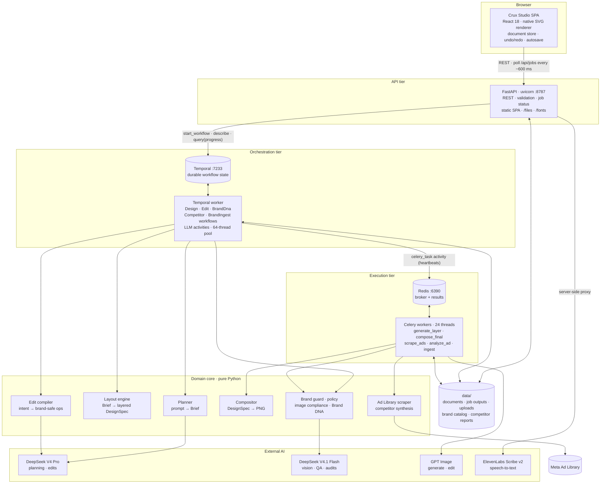
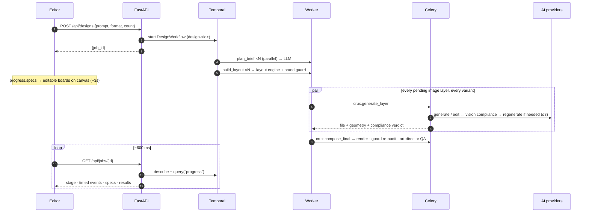
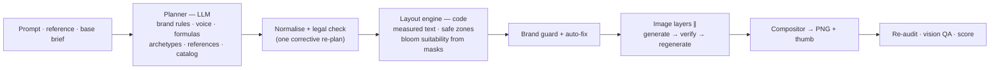

# Crux Studio — Layered AI Image Editor with a Brand Copilot

Crux Studio produces **layered, editable, brand-compliant** social ads. Describe an ad, click any layer and say
what to change, drop a comment on an element, speak an edit, or ask for *"4 different images like this"*. Every
headline, photo, bloom, charm, CTA and logo is its **own layer** on the canvas. Brand and legal rules (the Xero
brand kit in `Candidate-resources/`) are enforced by code at every stage.

Under the hood it is a **durable, event-driven AI pipeline**:

* **FastAPI** gateway.
* **Temporal** workflows for orchestration and progress.
* **Celery/Redis** for parallel image generation.
* A **deterministic layout engine** and a **shared layer model**, so the browser canvas, the server compositor
  and the auditors all see the same picture.

```bash
cp .env.example .env     # add the OpenAI + DeepSeek keys (git-ignored)
./run.sh                 # Redis + Temporal + Celery + worker + API/editor → http://localhost:8787
```

📚 **Full engineering docs:** [`docs/`](docs/README.md): architecture, backend, end-to-end flows, design engine,
data model, API reference, frontend, operations.

---

## Contents

- [High-level design (HLD)](#high-level-design-hld)
- [Request lifecycle](#request-lifecycle)
- [Backend architecture](#backend-architecture)
- [Design engine](#design-engine)
- [Brand & legal compliance](#brand--legal-compliance)
- [Reliability & concurrency](#reliability--concurrency)
- [API surface](#api-surface)
- [Features](#features)
- [Getting started](#getting-started)
- [Testing](#testing)
- [Security](#security)
- [Repository layout](#repository-layout)

---

## High-level design (HLD)



| Tier | Responsibility | Technology |
|---|---|---|
| **Client** | Owns the live document; renders boards as SVG from the shared layer model; applies compiled edit ops locally (undoable); debounced autosave | React 18, TypeScript, Vite |
| **API** | Input validation and limits, document persistence, uploads, server-side render/export, speech proxy; starts workflows and reports job status + live progress | FastAPI, Pydantic v2, uvicorn |
| **Orchestration** | Decides *what* runs and in what order; retries, timeouts, heartbeats; publishes a versioned `progress` snapshot for streaming UX | Temporal (Python SDK) |
| **Execution** | Fans out slow I/O and CPU work: every image layer of every variant in parallel, compositing, scraping, per-ad vision | Celery, Redis |
| **Domain core** | Pure, framework-free functions: plan, lay out, compile edits, render, audit, enforce policy | Python, Pillow, NumPy, potrace, Playwright |
| **AI providers** | Text reasoning, vision, image generation, speech | DeepSeek V4 Pro / V4.1 Flash (Azure, OpenAI-compatible), GPT Image, ElevenLabs Scribe v2 |

**Core architectural decisions**

1. **The LLM decides *what*, code decides *where*.** The planner returns a validated `Brief`: copy, archetype,
   colourway, visual, bloom, charms, stat. A deterministic layout engine turns it into geometry using real font
   metrics, brand spacing and safe zones, so there is no overlapping or overflowing text.
2. **One layer model end-to-end.** `DesignSpec`/`Layer` (`backend/crux/design/spec.py` ⇄ `editor/src/model/types.ts`)
   is shared by the planner, layout engine, edit compiler, compositor, brand guard, Brand DNA and the SVG renderer.
3. **Progressive delivery.** Boards appear in about 3s, as soon as the layout exists. Image layers stream into their
   placeholders as each finishes (~20s), and the board stays editable throughout.
4. **Intent ops → compiled ops.** For edits the LLM emits intent (`set_text`, `edit_image`, `transform` …).
   `compile_ops` turns it into exact, policy-checked document ops: text re-fitted with real metrics, colours snapped
   to the palette, CTA buttons resized, legal lines added, forbidden changes blocked.
5. **Defence in depth for compliance.** Rules are in every prompt *and* enforced deterministically after the model
   answers, including WCAG contrast measured from real pixels and vision verification of every generated image.

➡ Deep dive: [docs/01-architecture.md](docs/01-architecture.md)

---

## Request lifecycle

Every AI operation is an asynchronous, durable job:



| Workflow | Pipeline |
|---|---|
| `DesignWorkflow` | [vision-read reference] → plan N briefs ∥ → N layouts + brand guard ∥ → all image layers ∥ (Celery) → compose + audit + QA per variant |
| `EditWorkflow` | LLM intent → `compile_ops` (policy, text fit, palette snap, legal line) → image jobs ∥ → merged ops |
| `BrandDnaWorkflow` | measured audit (layers + pixels) → vision audit grounded in measured facts → merge, dedupe (IoU), score |
| `CompetitorWorkflow` | Meta Ad Library scrape → longevity tiers → per-ad vision ∥ (20s deadline) → synthesis → on-brand ideas |
| `BrandIngestWorkflow` | vectorise logo/blooms/waves → slice 251 charms → vision-tag assets ∥ → analyse references → insights → catalog |

➡ Sequence diagrams for every flow: [docs/03-flows.md](docs/03-flows.md)

---

## Backend architecture

```
backend/crux/
├── api/main.py          FastAPI: REST, validation, job status, static SPA, speech proxy
├── workflows/           Temporal workflows, activities, worker (task queue crux-design)
├── tasks/               Celery app + thin idempotent tasks over domain code
├── design/              spec · brief · planner · layouts · fonts · editor · layers · compose · docs
├── brand/               kit · policy · guard · compliance · dna · ingest · vectorize
├── research/            adlibrary (Playwright scraper) · competitors (analysis + synthesis)
├── llm.py               JSON-mode chat client: retries, jittered backoff, Pro⇄Flash fallback
├── imagegen.py          GPT Image generate/edit, size selection, transparent trim, retries
└── config.py            pydantic-settings, SecretStr, no secret defaults
```

**Layering rule:** `api`, `workflows` and `tasks` depend on the domain packages (`design`, `brand`, `research`);
the domain packages never import them. Workflow code imports only deterministic helpers, which keeps Temporal
replay safe.

**Model routing**

| Tier | Model | Used for |
|---|---|---|
| `pro` | DeepSeek V4 Pro | creative briefs, edit planning, competitor synthesis (text-only, strongest reasoning) |
| `flash` | DeepSeek V4.1 Flash | everything with vision: asset tagging, reference analysis, image compliance, art-director QA, Brand DNA, ad analysis |
| image | GPT Image (Flare) | photos, transparent cut-outs, brand-style charms/illustrations from catalog style references, in-place photo edits |
| speech | ElevenLabs Scribe v2 | voice edits (`no_verbatim`), proxied so the key stays on the server |

➡ Deep dive: [docs/02-backend.md](docs/02-backend.md)

---

## Design engine



* **Five layout archetypes** distilled from the reference ads: `card_photo`, `navy_illustration`, `photo_bloom`,
  `device_showcase`, `checklist`. Four colourways and four formats (4:5, 1:1, 9:16, 1.91:1).
* **Measured typography.** Text is measured with the same Barlow TTFs the browser loads. Headlines break at
  sentence boundaries and are line-balanced. Story formats respect Meta safe zones (top 14%, bottom 35%).
* **Variety comes from code.** "4 like this" forces a different archetype, colourway and bloom per variant
  instead of relying on the model to vary its output.
* **Rendering parity.** The browser SVG renderer and the Pillow compositor read the same layer model and fonts.
  The E2E suite measures a mean canvas-vs-server difference of about 3/255.

➡ Deep dive: [docs/04-design-engine.md](docs/04-design-engine.md) · data model: [docs/05-data-model.md](docs/05-data-model.md)

---

## Brand & legal compliance

`backend/crux/brand/policy.py` is the single source of non-negotiable rules, enforced at four stages:

| Stage | Enforcement |
|---|---|
| **Plan** | Banned claims (guaranteed, best, #1, risk-free, free forever, 100%, cheapest, unlimited) and competitor names trigger a corrective re-plan with legal feedback |
| **Generate** | Image rules in every prompt; each AI image is checked by a vision model for text, logos, watermarks, competitor branding, unsafe content and off-palette colour (non-photos), and regenerated with a targeted correction (≤3 attempts) |
| **Edit** | The wordmark can't be removed, replaced, redrawn, rotated or recoloured outside navy/white/sky. Colours snap to the palette. Offer copy automatically gets "Terms apply." Blocked requests become the closest compliant change |
| **Audit** | Brand guard: palette, brand fonts, logo colourway from sampled background pixels, logo size and clear space, WCAG 4.5:1 contrast, safe zones, headline length, charm count. **Brand DNA** scores 6 dimensions with located, one-click-fixable findings |

---

## Reliability & concurrency

| Mechanism | Detail |
|---|---|
| Durable orchestration | Temporal persists workflow state; a worker restart resumes jobs instead of losing them |
| Layered retries | LLM/image clients: 4 attempts with jittered exponential backoff on 429/5xx/timeouts/bad JSON, then Pro⇄Flash fallback. Temporal: 3 attempts per activity with backoff |
| Heartbeats & cancellation | The Celery bridge activity heartbeats every poll (30s timeout) and revokes the Celery task if the workflow is cancelled |
| At-least-once execution | Celery `acks_late` + `reject_on_worker_lost`, prefetch 1; tasks are idempotent with versioned output paths |
| Graceful degradation | A failed image layer doesn't fail the design (layer marked `failed`, retryable on canvas); compliance/QA reviewers fail open as "unverified"; the competitor analysis stage has a 20s deadline |
| Parallelism | 64 concurrent Temporal activities; 24 Celery threads, so all image layers of 4 variants render at once |

---

## API surface

| Endpoint | Purpose |
|---|---|
| `POST /api/designs` | create 1–4 designs (prompt, format, optional reference board / image / library ref / competitor creative) |
| `POST /api/edits` | edit targeted layers from chat, a comment pin or voice |
| `POST /api/brand-dna` | audit a board → scored, located, fixable findings |
| `POST /api/competitors` · `GET /api/competitors/latest` | Meta Ad Library scan → patterns + on-brand ideas |
| `GET /api/jobs/{id}` | job status + live progress + result |
| `GET·PUT /api/docs/{id}` | load / autosave a document |
| `POST /api/uploads` · `POST /api/render` | image upload · server-rendered PNG export |
| `POST /api/voice/transcribe` · `GET /api/voice/status` | speech-to-text proxy |
| `GET /api/brand` · `/api/brand/assets` · `/api/references` · `POST /api/brand/reindex` | brand kit, asset catalog, references, re-ingestion |
| `GET /api/health` | API, Temporal, Celery, catalog health |

➡ Full request/response reference: [docs/06-api-reference.md](docs/06-api-reference.md)

---

## Features

| Feature | How | What happens |
|---|---|---|
| **Create** | Copilot → describe the ad, pick 4:5 · 1:1 · 9:16 · 1.91:1 | A board with ~10 named layers appears in ~3s; photos stream into their placeholders (~20s) |
| **Edit a layer** | Select a layer, type the change | Only that layer changes: copy re-fitted with real font metrics, colours snapped to the palette, photos edited in place |
| **Comment to edit** | `C`, click a layer, write the change | The layer under the pin is edited; Crux replies in the thread and resolves it |
| **Variations** | With a board open: "Create 4 different images like this" | 4 deliberately different directions (layout, colourway, copy angle) in parallel |
| **Brand DNA** | 🧬 button | Score + 6 dimensions, every violation located; *Fix N automatically*, per-issue *Fix/Show*, *Pin issues on canvas*, *Re-check* |
| **Voice to edit** | Press `M` and speak, e.g. "make the headline say get paid in days" | Scribe v2 transcription → runs as an edit on the selected layer or board; auto-stops on silence |
| **Competitor intel** | *Competitors* tab → category + country | ~20 public Meta Ad Library ads, **days active** as the performance proxy, vision read of each creative, longevity-weighted patterns, 5 original on-brand ideas with *Create this →*, *Remix on-brand* on any ad |
| **Export** | *Export PNG* | Server-rendered PNG of the board |

**Editor:** zoom/pan, deep-select into groups and masked photos, 8-handle resize, inline text editing, nudge,
duplicate, undo/redo, layers tree (rename, hide, lock, reorder), design inspector (geometry, palette with
off-palette warning, brand fonts, image replace, per-image policy verdict), brand kit browser (323 AI-tagged
assets), references library, autosave.

---

## Getting started

**Prerequisites (macOS):** `brew install redis temporal potrace node python@3.13`. No Docker needed.

```bash
cp .env.example .env     # OPENAI_API_KEY, DEEPSEEK_PRO_*, DEEPSEEK_FLASH_*, optional ELEVENLABS_API_KEY
./run.sh                 # first run also analyses the brand kit (~1 min)
```

| Command | |
|---|---|
| `./run.sh` | start everything and open the studio |
| `./run.sh status` | health of API, Temporal, Celery |
| `./run.sh test` | backend smoke tests + Playwright E2E |
| `./run.sh stop` | stop all services |

| URL | |
|---|---|
| http://localhost:8787 | landing page |
| http://localhost:8787/studio | the editor |
| http://localhost:8233 | Temporal UI (every job's history, retries, inputs/outputs) |

Voice editing needs an ElevenLabs key (`ELEVENLABS_API_KEY=...`). Without it the mic is disabled and everything
else works.

➡ Configuration, observability and the production scaling path: [docs/08-operations.md](docs/08-operations.md)

---

## Testing

* **`scripts/smoke_test.py`** — API-level: create (4 formats), variations and a layer edit through Temporal + Celery.
* **`tests/e2e_studio.py`** — real Chromium against the running studio: create (every image layer loaded +
  canvas-vs-server pixel diff), AI layer edit, photo edit, comment edit, manual drag/undo/inline text,
  4 variations, Brand DNA on an off-brand fixture with pins and Fix-all, voice-to-edit through a fake microphone,
  comment-popover dismissal, and a live Ad Library scan → idea → board and remix → board. Runs use throwaway
  documents (`?doc=e2e-…`); screenshots go to `logs/e2e/`.

---

## Security

* Keys live only in `.env` (git-ignored) and are loaded as `SecretStr`: never logged, never sent to the browser.
* All services bind to `127.0.0.1`; CORS is restricted to the app origin.
* Pydantic bounds on every input; uploads size-capped (12 MB) and re-encoded by Pillow; audio ≤ 10 MB; documents
  ≤ 8 MB; ids validated by regex; reference file paths confined to `data/competitors/`.
* Celery accepts JSON only.

---

## Repository layout

```
├── backend/crux/            Python backend (see Backend architecture)
├── backend/assets/fonts/    Barlow / Barlow Condensed (SIL OFL) — shared by server and browser
├── editor/                  React + Vite SPA (Crux Studio + landing page)
├── Candidate-resources/     Xero brand kit + reference ads (ingested into data/brand/)
├── docs/                    Engineering documentation
├── scripts/                 smoke test
├── tests/                   Playwright E2E + fixtures
├── run.sh                   one-command runner
└── .env.example             configuration template
```

Fonts: Barlow / Barlow Condensed (SIL OFL), the closest open match to Xero's typeface.
