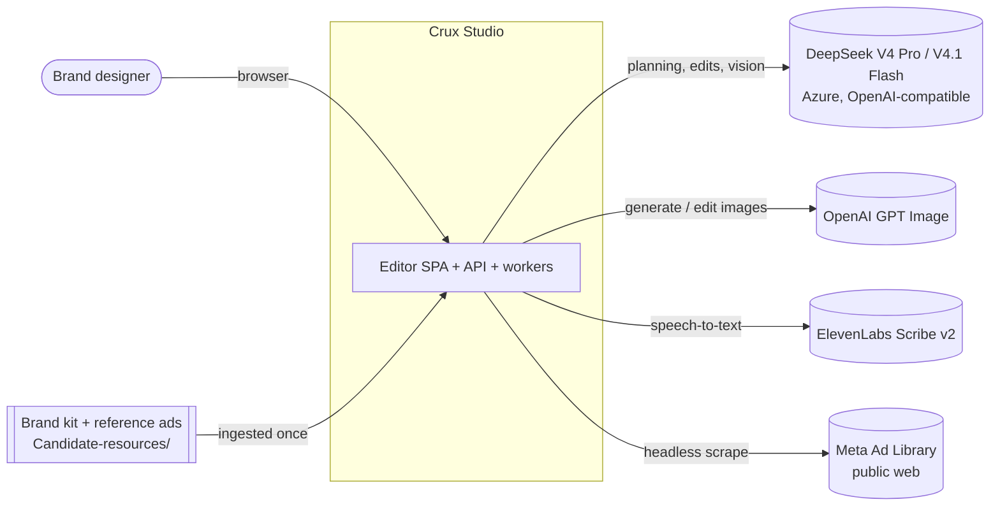
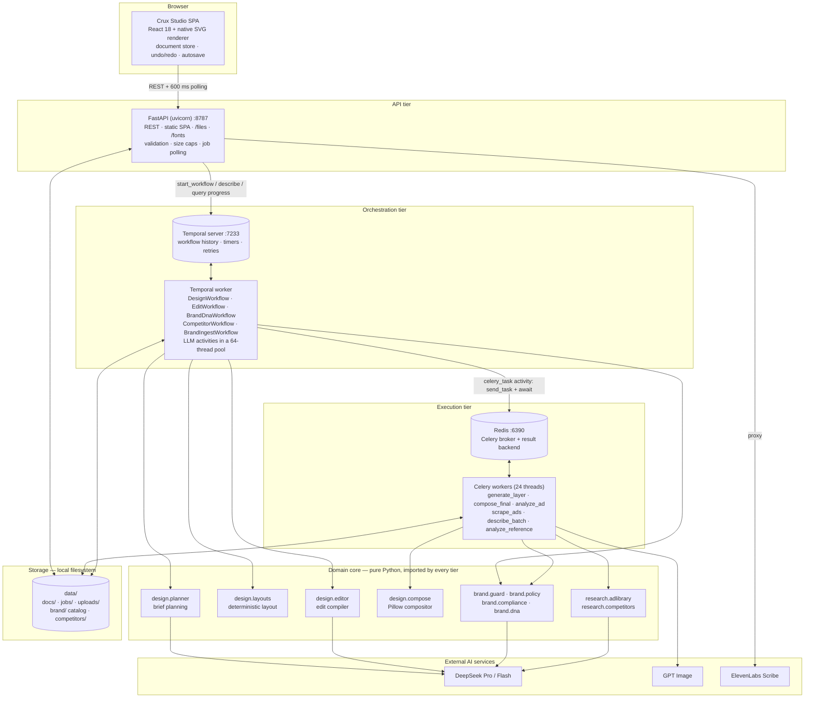
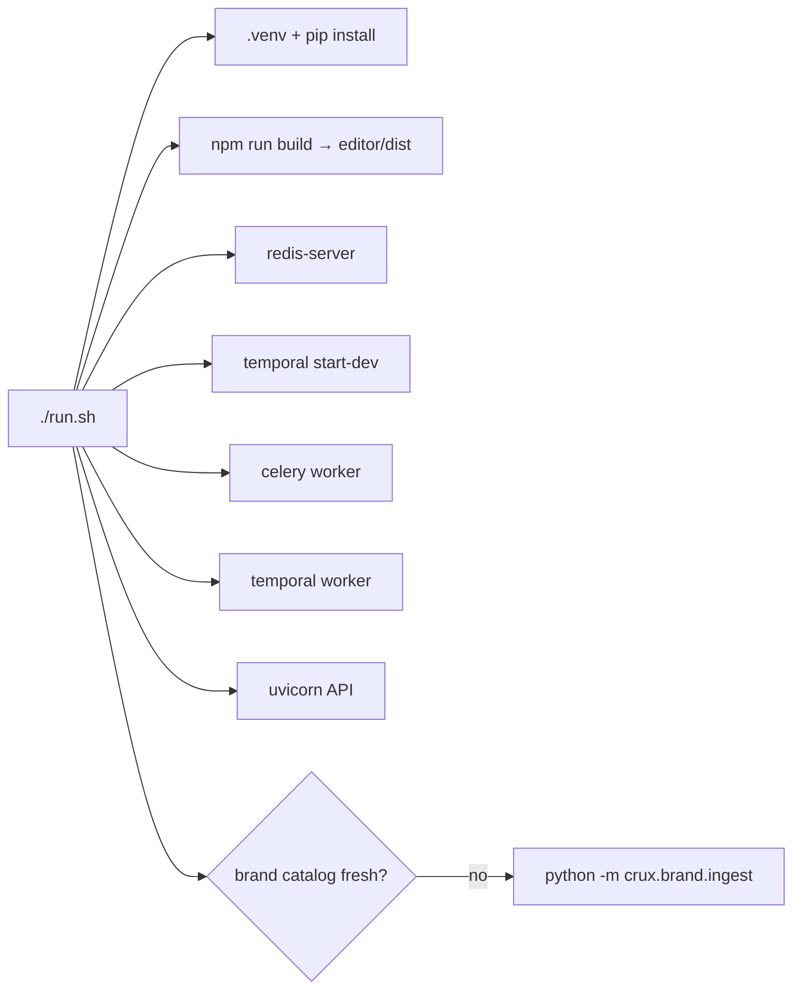

# 1. Architecture

## 1.1 Problem statement

Brand teams need on-brand social ads quickly, and they need to keep editing them afterwards. Text-to-image models
return one flat bitmap. You can't move the headline, swap the photo or recolour the CTA, and nothing guarantees the
logo, palette, fonts or legal copy are correct.

Crux Studio produces **layered** designs: every headline, photo, bloom, charm, CTA and logo is its own editable
layer. A copilot creates, edits, varies and audits those layers. Brand and legal rules are enforced by code at
every stage, not left to the model.

### Design goals

| Goal | How the architecture meets it |
|---|---|
| Every element editable | One shared layer model (`DesignSpec`) used by the planner, layout engine, compositor, editor and auditors |
| Consistent, clean layouts | The LLM decides *what* (copy, archetype, visuals); deterministic code decides *where* (geometry, measured text) |
| Brand & legal safety | Policy checks at plan time, edit time, image-generation time and audit time; unsafe edits are blocked or converted |
| Fast perceived latency | Boards appear in ~3s once the layout exists; image layers stream in as each finishes (~20s) |
| Durable long-running AI jobs | Temporal workflows survive worker restarts and expose a live `progress` query |
| High parallelism for slow I/O | Celery fans every image layer of every variant out across a thread pool at once |
| What you see is what you export | The browser SVG renderer and the server Pillow compositor read the same layer model and font files |

## 1.2 System context

## 1.3 High-level design

### Tier responsibilities

| Tier | Process | Responsibility | Never does |
|---|---|---|---|
| Client | Browser SPA | Owns the live document, selection, undo/redo; renders boards as SVG; applies compiled edit ops; autosaves | Call AI providers directly or hold secrets |
| API | `uvicorn crux.api.main:app` | Validates input, persists documents/uploads, renders exports, starts workflows, reports job status, proxies speech | Run long AI work inline (it returns a job id right away) |
| Orchestration | `python -m crux.workflows.worker` | Decides *what* runs and in which order; retries, timeouts, heartbeats; exposes progress | Hold large binaries in workflow state (only file paths) |
| Execution | `celery -A crux.tasks.app:celery_app worker` | Heavy I/O and CPU: image generation + vision QA, compositing, scraping, per-ad analysis | Own retry policy (Temporal does) |
| Domain core | `backend/crux/{design,brand,research}` | Pure functions: plan, lay out, compile edits, render, audit | Know about HTTP, Temporal or Celery |

## 1.4 Runtime topology

All services bind to `127.0.0.1` and run as native processes started by `./run.sh`. No containers are needed.

| Service | Port | Started by | Logs |
|---|---|---|---|
| FastAPI + SPA | 8787 | `uvicorn crux.api.main:app` | `logs/api.log` |
| Temporal dev server | 7233 (gRPC), 8233 (UI) | `temporal server start-dev --db-filename .run/temporal.db` | `logs/temporal.log` |
| Temporal worker | — | `python -m crux.workflows.worker` (task queue `crux-design`) | `logs/worker.log` |
| Redis | 6390 | `redis-server --save "" --appendonly no` | `logs/redis.log` |
| Celery | — | `celery … worker --pool threads --concurrency 24` | `logs/celery.log` |

## 1.5 Technology choices

| Concern | Choice | Why |
|---|---|---|
| API | FastAPI + Pydantic v2 | Typed request models give validation and limits for free; async handlers for Temporal/httpx calls |
| Durable orchestration | Temporal | AI jobs run 3–60s across many dependent steps. Temporal provides persisted state, per-activity retry policies, timeouts, heartbeats and a queryable progress snapshot without hand-rolled job tables |
| Parallel execution | Celery on Redis (thread pool) | Image calls are I/O-bound and slow (~15–20s). A 24-thread pool runs every layer of four variants at once. `acks_late` + `reject_on_worker_lost` redeliver work if a worker dies |
| Planning LLM | DeepSeek V4 Pro | Strongest reasoning for briefs and edit plans (text-only) |
| Vision LLM | DeepSeek V4.1 Flash | Fast multimodal: asset tagging, reference analysis, image compliance, QA, Brand DNA, competitor reads |
| Image model | GPT Image (Flare) | Generation and in-place edits, transparent backgrounds for cut-outs, charms and illustrations |
| Speech | ElevenLabs Scribe v2 | Accurate short-utterance transcription with `no_verbatim`; key stays server-side |
| Compositing | Pillow + the same TTF files as the browser | Pixel-faithful server renders for previews, exports and audits |
| Vectorisation | potrace | Blooms, waves and the wordmark become recolourable SVG paths |
| Scraping | Playwright (Chromium, headless) | The Meta Ad Library is a JS app with no login-free API |
| Frontend | React 18 + Vite, no UI framework, native SVG | Small bundle; SVG gives crisp zoom and exact parity with the server layer model |
| Storage | JSON + files under `data/` | Zero-ops for a single-node studio; atomic writes; the storage seam is narrow (see §8 scaling) |

## 1.6 Key architectural decisions

1. **LLM decides what, code decides where.** The planner returns a validated `Brief` (copy, archetype, colourway,
   visual, bloom, charms, stat). `design/layouts.py` turns it into geometry with real font metrics, brand spacing
   and safe zones. This removes overlapping and overflowing text, which is the most common failure of LLM-placed
   layouts.
2. **One layer model everywhere.** `backend/crux/design/spec.py` and `editor/src/model/types.ts` describe the same
   structure. The planner, layout engine, edit compiler, compositor, brand guard, Brand DNA and SVG renderer all read
   it, so there is no translation layer to drift.
3. **Progressive delivery through workflow queries.** `DesignWorkflow` publishes a versioned `progress` snapshot
   (stage, events, specs, results). The editor polls it, places boards as soon as the layout exists and merges each
   image as it lands. The board stays editable the whole time.
4. **Intent ops → compiled ops.** For edits the LLM emits *intent* (`set_text`, `edit_image`, `transform` …).
   `compile_ops` turns intent into exact, brand-safe document ops: re-fitted text, palette-snapped colours, resized
   CTA buttons, policy blocks and an automatic legal line. The browser applies the ops locally, so undo/redo works.
5. **Compliance is layered defence.** Rules are in every prompt *and* enforced deterministically after the
   model answers: copy regex, logo colourways, palette snap, WCAG contrast sampled from real pixels, vision
   verification of every AI image with targeted regeneration.
6. **Temporal owns retries; Celery tasks are thin and idempotent.** Activities wrap Celery with heartbeats, and
   cancellation revokes the Celery task. Layer outputs are versioned file names, so retries never corrupt earlier
   results.
