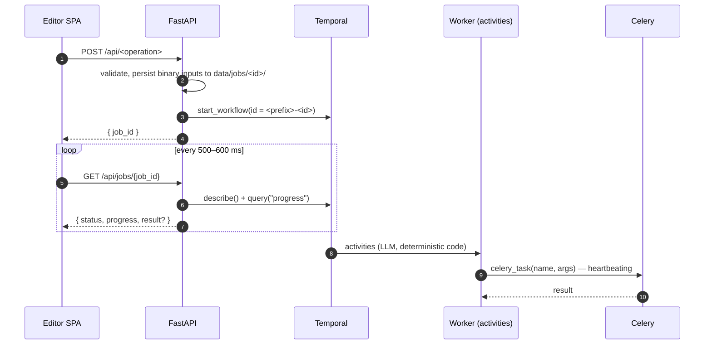
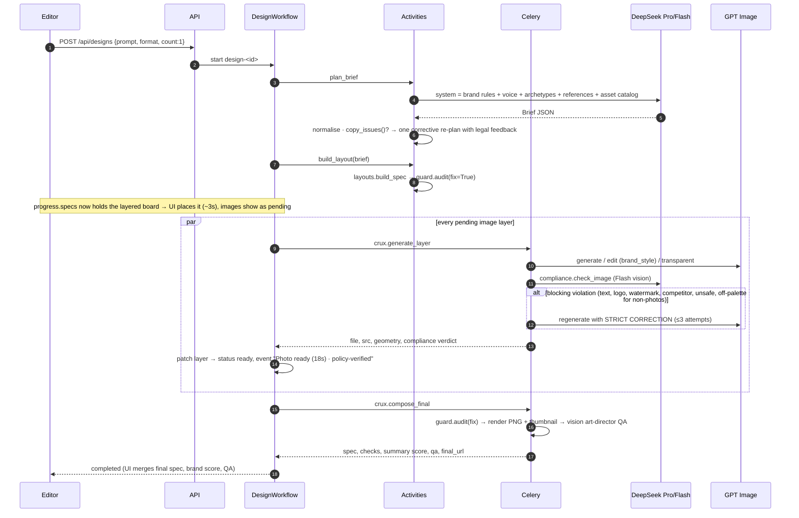
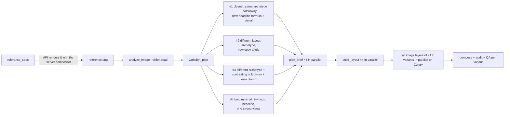
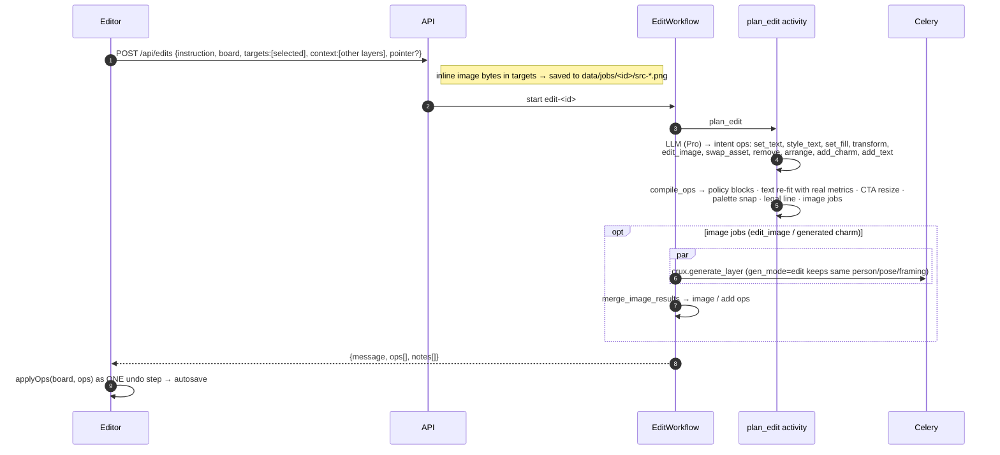
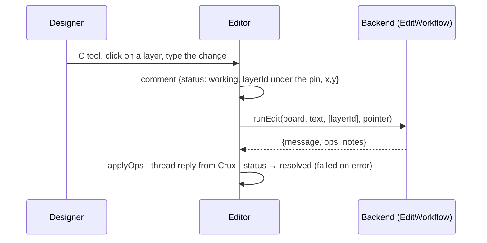
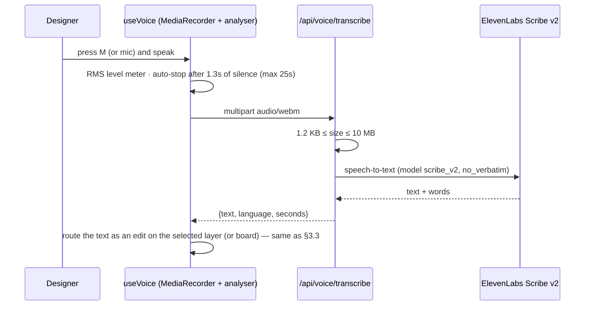
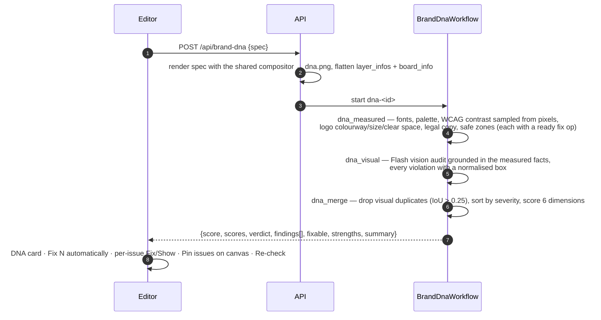
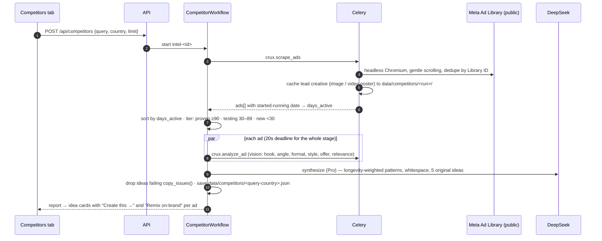
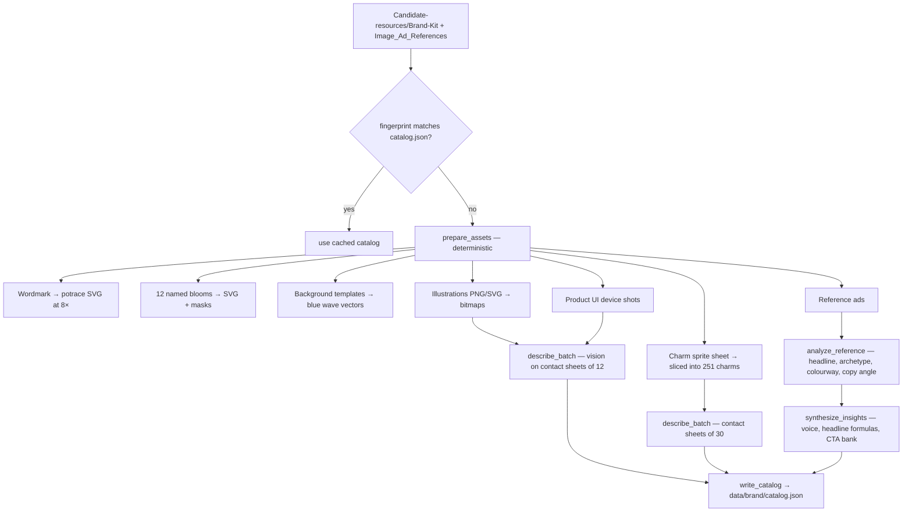

# 3. End-to-end flows

Every AI flow follows the same asynchronous pattern:

---

## 3.1 Create a design (one board)

Trigger: the Copilot composer with no board selected (or text such as "new design …"), format 4:5 · 1:1 · 9:16 · 1.91:1.

**What the user sees.** A board with ~10 named layers appears in about 3s. Photos and illustrations fill their
placeholders as each one finishes (~20s). The job card streams timed events ("Brief: …", "Photo ready …", "Variant 1:
brand check 96/100, art-director score 8/10"). The board is editable from the first frame. Server merges (`mergeFromServer`) only fill in pending images,
brand-guard colour fixes and guard-added layers, so the designer's own moves and copy changes are kept.

## 3.2 Variations ("Create 4 different images like this")

`inferIntent` detects a count > 1 while a board is open. The editor sends `count: 4`, `reference_spec` (the current
board), and `base_brief` (if Crux made the board).

Variety comes from code, not from hoping the model varies its output. Each variant gets a forced archetype from a
rotation, a colourway override for #3, and its own bloom (a deterministic pick seeded by the base headline, never
repeated within the set).

## 3.3 Edit a layer (chat)

Trigger: a layer is selected and the designer types an instruction. Without a selection, edit-like verbs
(`make|change|replace|move|recolour|…`) run a board-scoped edit.

Examples of compile-time guarantees:

| Instruction | Compiled result |
|---|---|
| "Make the headline say *Get paid in days*" | `update` with text balanced across ≤3 lines and font size re-fitted to the original box |
| "Change the CTA to *Start your free trial today*" | Label re-fitted **and** CTA background resized to the new label width; offer detected → "Terms apply." layer added under the CTA |
| "Make the background orange" | Colour snapped to the nearest brand colour, with a note: "#FF8800 snapped to brand …" |
| "Remove the logo" / "rotate the logo" | Blocked: "the Xero wordmark is mandatory …" |
| "Say we're the best accounting app" | Blocked: "Unapproved claim 'best' needs legal sign-off" |
| "Make her smile" (photo) | `edit_image` mode=edit on the existing file: same person, pose, framing |

## 3.4 Comment to edit

The pin's board coordinates are sent as `pointer`, so position-relative requests ("add a sparkle here") are placed
at the pin.

## 3.5 Voice to edit

`GET /api/voice/status` reports whether a key is configured. Without one the mic is disabled and nothing else is
affected. The ElevenLabs key never reaches the browser.

## 3.6 Brand DNA audit and fix

"Fix" applies the finding's pre-compiled `fix` op locally, so it can be undone, and clears the stale pins. Fixes are
*coherent*: structural fills snap to primary colours first, then text and logo colours are chosen against the
background they will actually sit on.

## 3.7 Competitor intel (Meta Ad Library)

"Create this →" starts a §3.1 design seeded with the idea. "Remix on-brand" starts a design with
`reference_file` set to the cached competitor creative. The API confines that path to `data/competitors/`. The
synthesis prompt forbids reusing competitor copy, claims, characters or branding, and forbids naming any
competitor or advertiser.

## 3.8 Brand ingestion (first run / reindex)

`./run.sh` runs ingestion locally on first start (~1 min). `POST /api/brand/reindex` runs the same pipeline as a
durable `BrandIngestWorkflow`. The catalog fingerprint is computed from the source files' names and sizes, so editing
the brand kit triggers re-analysis.

## 3.9 Manual editing, autosave and export

* Direct manipulation (move, resize, inline text, nudge, duplicate, delete, reorder, hide/lock) mutates the document
  in the browser store. Drags snapshot one undo step at the start. The undo stack holds 120 steps.
* Every mutation schedules a debounced (700 ms) `PUT /api/docs/{id}`. The server writes atomically (temp file +
  rename) and rejects documents over 8 MB.
* **Export PNG** → `POST /api/render {spec, scale}` → the server compositor renders → `data/jobs/exports/*.png`.
