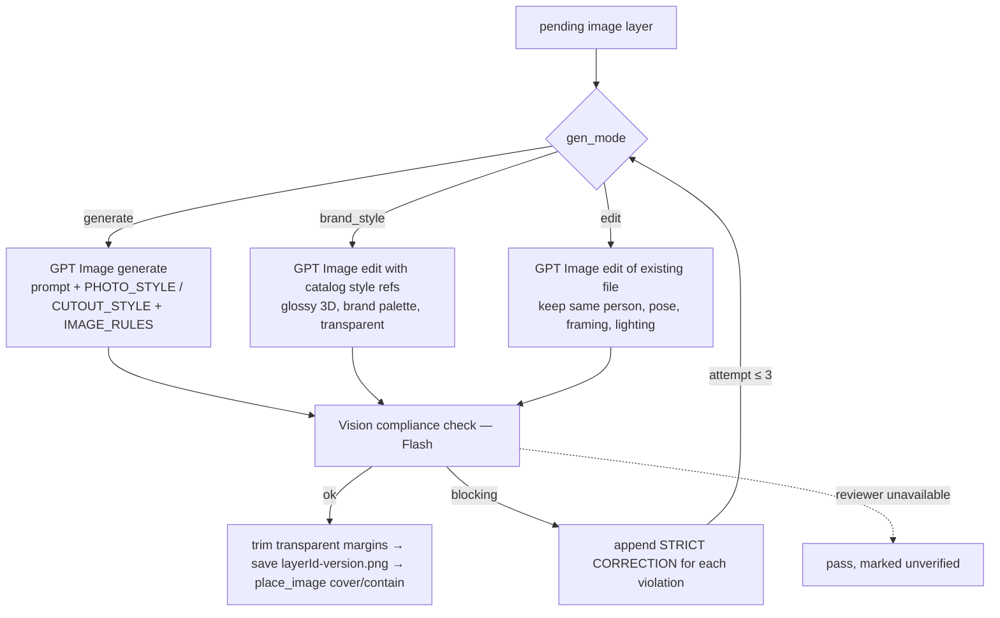

# 4. Design engine & brand compliance

## 4.1 Pipeline overview

```mermaid
flowchart LR
    P[Prompt / reference / base brief] --> PL["Planner (LLM)<br/>design/planner.py"]
    PL --> B[Brief<br/>validated, normalised]
    B --> LE["Layout engine (code)<br/>design/layouts.py"]
    LE --> S[DesignSpec<br/>~10 named layers]
    S --> BG["Brand guard<br/>brand/guard.py"]
    BG --> IG["Image layers<br/>design/layers.py + brand/compliance.py"]
    IG --> CO["Compositor<br/>design/compose.py"]
    CO --> QA[Guard re-audit + vision QA]
    QA --> OUT[Final spec · PNG · thumbnail · checks · score]
```

## 4.2 Planner: what to say and show

`planner.plan()` builds a system prompt from:

* `RULES_TEXT`: palette, logo usage, typography, blooms, photography, accessibility and story safe zones,
  transcribed from the Brand Kit guideline boards.
* Insights from ingestion: copy **voice**, **headline formulas**, approved **CTA bank**.
* The five **layout archetypes** and every analysed **reference ad**, as the quality bar.
* The **asset catalog** (illustrations, devices, charms) with exact ids.
* Visual rules and a legal/compliance section, plus a strict JSON schema.

The model's answer is **normalised** in code (`_normalize`):

| Archetype | Enforced visual | Default colourway |
|---|---|---|
| `card_photo` | generated photo (never navy: a white card reads best on light) | sky |
| `navy_illustration` | catalog illustration if it fits, else a generated 3D brand-style illustration | navy |
| `photo_bloom` | generated photo cropped inside a bloom | navy |
| `device_showcase` | catalog device shot (falls back to the first device) | sky |
| `checklist` | no hero visual; exactly 3 checklist pills (≤3 words) | navy |

Charms are filtered to real catalog ids (max 2). Empty headline/CTA get on-brand defaults. If the copy then fails
`policy.copy_issues()`, the planner runs **one corrective re-plan** with the specific legal feedback, so bad copy
never reaches the canvas.

## 4.3 Layout engine: where things go

`layouts.Builder` is deterministic. Its RNG is seeded from `headline + variant`, so the same brief always produces the
same board.

* **Units & margins:** `u = min(W/1080, H·1.6/1080)` scales every measurement. Margins are 64u (48u for landscape).
* **Story safe zones:** for 9:16, copy and logo stay out of the top 14% and bottom 35%, with 6% side margins.
* **Measured text:** `design/fonts.py` measures with the same Barlow / Barlow Condensed TTFs the browser loads.
  `fit()` searches the largest size that fits a box within max lines (with a 0.93 wrap safety). `fit_headline()`
  prefers breaking at sentence boundaries ("Data in. / Doubt out.") and balances line lengths.
* **Archetype builders:** `_card_photo`, `_navy_illustration`, `_photo_bloom`, `_device_showcase`, `_checklist`, each
  composing primitives: `rect`, `text`, `vector`, `asset_image`, `gen_image`, `group`, `mask`, `logo`, `cta`,
  `wave`, `charm`, `stat_card`, `_pills`.
* **Bloom suitability is measured, not hard-coded.** `bloom_profile()` reads each bloom's mask. Photo crops need a
  solid body (`PHOTO_MIN_FILL = 0.45`). Logo accents need a spot that can hold the wordmark (`spot_in_mask`). Blooms
  are varied across designs instead of defaulting to one.
* **Waves** are placed away from the copy. **CTA** width is computed from the label's measured width plus padding.
* Image layers are created with `status: "pending"`, a role (`photo`, `cutout`, `illustration`, `charm`), a prompt,
  `fit`/`anchor` and `gen_mode` (`generate` or `brand_style` with catalog style references).

## 4.4 Image layers and compliance loop

* **Blocking violations:** `text`, `logos`, `watermark`, `competitor`, `unsafe`, and `off_palette` for
  non-photo roles.
* The verdict (`ok`, `verified`, `attempts`, `blocking`, `fixed`, `notes`) is stored on the layer as `compliance`
  and shown in the inspector ("policy-verified", "regenerated 1× to remove text").
* The reviewer is advisory on the critical path (`attempts=2, timeout=20s`). An outage never blocks delivery, and
  the image rules are in every generation prompt anyway.

## 4.5 Compositor and rendering parity

`design/compose.py` (`Renderer`) draws a `DesignSpec` with Pillow: rects/ellipses with radius, stroke and shadow;
text with the brand TTFs, line height, letter spacing and alignment; images with `cover`/`contain` and anchors;
vectors from SVG paths; groups; masks (child 0 is the mask shape); opacity and rotation; any scale factor.

The browser renderer (`editor/src/render/BoardSvg.tsx`) draws the same model as native SVG with the same font files
and metrics (served from `/fonts` and `/api/brand`). The E2E suite measures **canvas vs server** pixel difference
on generated boards, about 3/255 mean. Chat thumbnails, exports, Brand DNA input and the live canvas are therefore
the same picture.

## 4.6 Brand guard (measured audit with safe auto-fixes)

`brand/guard.audit(spec, fix=True)` runs after layout and again at final compose:

| # | Rule | Check | Auto-fix |
|---|---|---|---|
| 1 | Palette | every `fill`/`color`/`stroke` (except photos) is a brand colour | snap to nearest palette colour (RGB distance) |
| 2 | Typography | text uses Barlow Condensed / Barlow only | switch to headline or body brand font by role |
| 3a | Legal | offer copy (free, %, £/$/€, voucher, discount, trial, per month) needs "Terms apply." | add a legal layer next to/under the CTA at a collision-free spot |
| 3b | Legal | banned claims / competitor names | warn |
| 4 | Logo | exactly one wordmark; colourway matches what is *behind* it (sampled from a render without text/logos); ≥12% width; approved colour; clear space ≥ 0.3× logo height | recolour to navy / white / sky |
| 5 | Contrast | WCAG AA 4.5:1 for every text layer against the sampled background | switch to the better of navy/white |
| 6 | Layout | headline/subhead/CTA/logo inside the canvas; 9:16 safe zones | warn |
| 7 | Imagery | every AI image compliance-verified | warn per failing layer |
| 8 | Copy discipline | headline ≤ 10 words; ≤ 2 charms | warn |

Summary score: `100 − 8·warnings − 2·fixed` (floor 0).

## 4.7 Legal & brand policy (`brand/policy.py`)

Single source of non-negotiable rules, used by the planner, edit compiler, guard, DNA and competitor synthesis:

* **Banned claims** (need legal sign-off): guaranteed, #1 / No. 1 / number one, best, risk-free, free forever, 100%,
  cheapest, unlimited.
* **Competitors**: QuickBooks, Intuit, MYOB, Sage, FreshBooks, Wave Apps, Zoho Books, NetSuite.
* **Offer detection** → mandatory `Terms apply.` line.
* **Logo**: approved colourways navy, white or sky only. It can't be removed, replaced, redrawn or rotated (enforced in
  `editor._policy_block`).
* **Image rules**: no text, letters, numbers, signage, logos, watermarks or readable screens; no competitor products;
  wardrobe in brand blues or neutrals; authentic, inclusive, optimistic; nothing unsafe, sexualised or political.

## 4.8 Brand DNA scoring (`brand/dna.py`)

* **Dimensions:** color, typography, logo, imagery, layout, copy.
* **Measured findings** carry a ready `fix` op and a normalised box. The wordmark is audited as one unit; its nested
  vector paths are ignored. Contrast samples a thin ring just outside each text box in the exported PNG.
* **Visual findings** (Flash vision) are grounded in the measured facts ("trust these over visual impression"), which
  catches flattened/raster ads, text inside photos, off-brand imagery and tone. Visual duplicates of measured
  findings (same dimension, IoU > 0.25) are dropped.
* **Per-dimension score** = `min(vision score, 100 − Σ severity cost)` with costs high 18, medium 9, low 4.
* **Overall** = weighted mean (color 1.2, typography 1.0, logo 1.3, imagery 1.0, layout 0.8, copy 1.2).
* **Verdict:** *On-brand* (≥ 85 and no high-severity finding) · *Needs fixes* (≥ 60) · *Off-brand*.

## 4.9 Brand constants (`brand/kit.py`)

| Token | Value | Use |
|---|---|---|
| navy | `#000856` | primary text on light, dark backgrounds |
| blue | `#1F65D6` | blooms, waves |
| sky | `#3ECCFF` | logo/highlights on navy |
| sky_soft | `#6BC9F9` | light-blue ad backgrounds |
| white / paper | `#FFFFFF` / `#F9F8F6` | cards |
| mint, green, yellow, pink, lilac | accents | charms and small details only |

Formats: feed 1080×1350, square 1080×1080, story 1080×1920, landscape 1200×628. Fonts: Barlow Condensed 700
(headline), Barlow 400/500 (body), Barlow 600 (CTA), SIL OFL, the closest open match to Xero's typeface.
