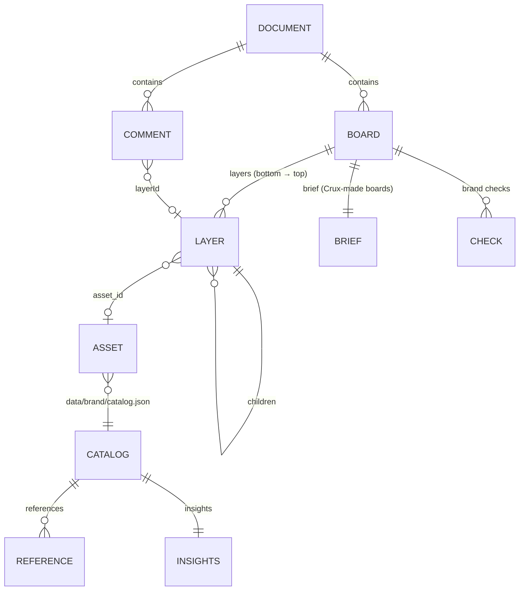

# 5. Data model & storage

## 5.1 Entity overview



## 5.2 `DesignSpec` (board)

Defined in `backend/crux/design/spec.py` and mirrored in `editor/src/model/types.ts`.

| Field | Type | Notes |
|---|---|---|
| `id` | `d_<10 hex>` | |
| `name`, `format` | str | format ∈ feed · square · story · landscape |
| `width`, `height` | int | board pixels |
| `background` | hex | |
| `layers` | `Layer[]` | z-order bottom → top |
| `brief` | object | the planner's `Brief`; present ⇒ Crux-made (`is_crux`) |
| `checks` | `{rule, status: pass·fixed·warn, detail, layer}[]` | brand guard results |
| `preview_url`, `variant` | | thumbnail, index within a variation set |
| *editor only* | `job_id`, `final_url`, `qa`, `summary` | bookkeeping |

## 5.3 `Layer`

| Group | Fields |
|---|---|
| Identity | `id`, `name`, `kind` (rect · ellipse · text · image · vector · group · mask), `role` (headline, subhead, cta, cta_bg, cta_label, logo, photo, cutout, illustration, charm, bloom, wave, card, stat, legal, pill_text, …) |
| Geometry | `x`, `y`, `w`, `h` (board px, top-left origin), `rotation`, `opacity`, `hidden`, `locked` |
| Shape | `fill`, `radius`, `stroke`, `stroke_width`, `shadow` |
| Text | `text`, `font` (brand key), `font_family`, `font_weight`, `font_size`, `line_height`, `letter_spacing`, `color`, `align` |
| Image | `src` (public URL), `file` (path under `data/`), `asset_id`, `prompt`, `transparent`, `fit` (cover · contain), `anchor`, `status` (ready · pending · failed), `gen_mode` (generate · brand_style · edit), `style_refs`, `compliance` |
| Vector | `svg_url` or inline `svg` |
| Tree | `children` (for `mask`, `children[0]` is the mask shape) |

`role` drives behaviour across the system: the layout engine assigns it, and the edit compiler (text fitting, CTA
resize, logo protection), the guard, DNA (structural vs content fills) and the legal-line placement all read it.

## 5.4 Brief

`name, format, archetype, colorway, headline, subhead?, cta, checklist[≤4], visual{source, kind, asset_id?, prompt?},
bloom (one of 12), wave, charms[≤2], stat{label, value}?, rationale`. Validators coerce unknown formats and blooms
to safe defaults.

## 5.5 Document

```json
{
  "id": "xero-campaign",
  "name": "Xero campaign",
  "boards": [ /* DesignSpec[] */ ],
  "comments": [
    { "id": "c_…", "boardId": "d_…", "x": 540, "y": 220, "layerId": "l_…",
      "kind": "edit | dna", "severity": "high|medium|low",
      "status": "open | working | resolved | failed",
      "thread": [ { "author": "designer | crux", "text": "…", "at": 1760000000000 } ] }
  ],
  "updated": 1760000000.0
}
```

## 5.6 Edit operations (the edit contract)

Produced by `editor.compile_ops` (and DNA fixes), applied by `editor/src/model/layers.ts#applyOps`:

| Op | Shape | Effect |
|---|---|---|
| `update` | `{target, props}` | merge props into a layer |
| `image` | `{target, src, file?, prompt?, x?,y?,w?,h?, asset_id?, name?}` | replace a layer's pixels (geometry kept unless provided) |
| `vector` | `{target, svg_url, fill?, asset_id?, x,y,w,h}` | swap to a vector asset |
| `remove` | `{target}` | delete layer |
| `arrange` | `{target, to: front · back}` | z-order |
| `add` | `{layer}` | insert a new layer |

Ops target layer **ids**, never indices, so they stay valid while the designer keeps editing during a job.

## 5.7 LLM-facing flattening

`docs.layer_infos(spec)` (backend) and `layerInfos(board)` (frontend) produce the same flat list per visible
layer: `{id, name, type, role, parent_id, x, y, w, h, rotation, asset_id, text…|image{src,file,prompt,transparent}|fill}`.
The edit planner and Brand DNA reason over this list, which keeps prompts compact and keeps the frontend and
backend in agreement.

## 5.8 Brand catalog (`data/brand/catalog.json`)

| Field | Content |
|---|---|
| `fingerprint` | SHA-1 over source file names + sizes (+ pipeline version); stale ⇒ re-ingest |
| `assets[]` | `{id, category: logo·bloom·background·illustration·charm·device·reference, name, file, width, height, has_alpha, colors[], description, tags[], vector?, mask?}` (≈323 assets) |
| `references[]` | analysed reference ads: headline, subhead, cta, archetype, colorway, visual, elements, copy_angle, layout_notes |
| `insights` | `voice[]`, `headline_formulas[]`, `cta_bank[]` |

`load_kit()` caches the parsed catalog keyed on the file's mtime, so a re-index is picked up without a restart.

## 5.9 On-disk layout (`data/`, git-ignored)

```
data/
├── brand/            catalog.json, assets/, vectors/, masks/   ← ingestion output, served at /files/brand/
├── docs/<id>.json    documents (atomic write via .tmp + rename, ≤ 8 MB)
├── jobs/<job_id>/    reference.png, src-*.png, <layer>-<version>.png, <spec>-final.png, <spec>-thumb.jpg, dna.png
├── jobs/exports/     exported PNGs
├── uploads/          user uploads normalised to PNG (random 12-hex names)
└── competitors/      <query-country>.json reports + <run_id>/ cached creatives
```

Temporal keeps workflow history in `.run/temporal.db`. Redis runs with persistence disabled; it only holds transient
Celery messages and results (1 h TTL).
