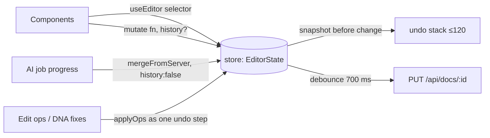

# 7. Frontend architecture

React 18 + TypeScript, built with Vite into `editor/dist` and served by the API. There is no UI framework or
state library: a small external store plus `useSyncExternalStore`.

## 7.1 Module map

```
editor/src/
├── main.tsx            "/" → Landing, "/studio" → App; test hook for Playwright
├── App.tsx             shell: top bar, tool rail, panels, canvas, copilot
├── model/
│   ├── types.ts        Layer / DesignSpec / Doc / CanvasComment / EditOp / LayerInfo (mirrors backend)
│   ├── store.ts        document + UI state, undo/redo (120 steps), debounced autosave
│   ├── layers.ts       tree helpers, applyOps, mergeFromServer, layerInfos/boardInfo
│   └── brand.ts        palette/fonts from /api/brand
├── render/
│   ├── BoardSvg.tsx    the renderer: layer model → native SVG
│   ├── fonts.ts        @font-face loading + metrics (same TTFs as the server)
│   └── vectors.ts      SVG asset fetch/cache, recolouring
├── canvas/
│   ├── Canvas.tsx      zoom/pan, hit-testing (deep select into groups/masks), drag, 8 resize handles, inline text
│   └── Comments.tsx    pins, threads, comment composer
├── panels/             Boards, Layers (tree, rename, hide, lock, reorder), Properties (inspector)
├── copilot/
│   ├── Copilot.tsx     chat composer, intent routing, job cards
│   ├── flows.ts        runDesign / runEdit / runCommentEdit / runBrandDna / applyDnaFixes / pinDnaFindings / inferIntent
│   ├── api.ts          typed client + pollJob
│   ├── DesignCard.tsx · DnaCard.tsx · GenerateLike.tsx
│   └── BrandTab.tsx · ReferencesTab.tsx · CompetitorsTab.tsx
├── voice/              useVoice (MediaRecorder + level meter + silence auto-stop), VoiceButton
└── landing/            marketing landing page with a scroll-driven feature story
```

## 7.2 State and persistence



* `?doc=<id>` selects the document (default `xero-campaign`). E2E tests use throwaway `e2e-<ts>` documents.
* Server merges (images landing, final specs) use `history: false`, so they never pollute undo. User-meaningful AI
  results (an applied edit, "Fix all") are a single undo step.
* `mergeFromServer` patches only server-owned fields: when a still-pending image lands it gets its `src`, `status`,
  geometry and `compliance`; brand-guard colour fixes are applied to text, rect and vector layers; and layers the
  guard added (e.g. "Terms apply.") are appended. Positions, copy and other edits the designer made while the job
  was running are kept.

## 7.3 Rendering

`BoardSvg` walks the layer tree and emits SVG: `rect`/`ellipse` with radius and shadow; `text` with brand fonts,
line height, letter spacing and alignment; `image` at its exact layer box (the backend has already resolved
`cover`/`contain` into geometry); `vector` as recoloured inline SVG; `mask` as an SVG `<mask>` built from child 0;
per-layer opacity and rotation; the board clipped to its bounds. Pending images show a "✦ Generating…" shimmer
placeholder, and failed ones show "Generation failed — ask Crux to retry".

The same component renders the live canvas, the Boards panel thumbnails and the copilot design cards.

## 7.4 Copilot intent routing (`inferIntent`)

| Condition | Intent |
|---|---|
| board open and text asks for N > 1 ("4 different images like this", "variations", "like this") | `variations(N ≤ 4)` |
| board open, a layer selected, not "new design …" | `edit(layer)` |
| board open, edit verbs (make, change, replace, move, swap, recolour, bigger, smaller, remove, add, edit, update, fix, shorten, rewrite) | `edit(board)` |
| otherwise | `create(count)` |

## 7.5 Keyboard & interaction

Select `V`, Text `T`, Rectangle `R`, Comment `C`, Pan `H` / Space-drag, Voice `M`; zoom ⌘/Ctrl+wheel, `+`/`-`,
`Shift+1` fit; arrows nudge; `⌘D` duplicate; `Delete`; `⌘Z` / `⇧⌘Z`. Drag & drop an image file to upload. Corner
handles keep aspect for images and vectors.
